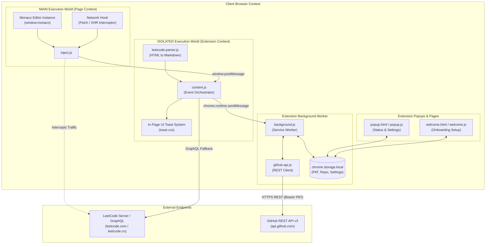
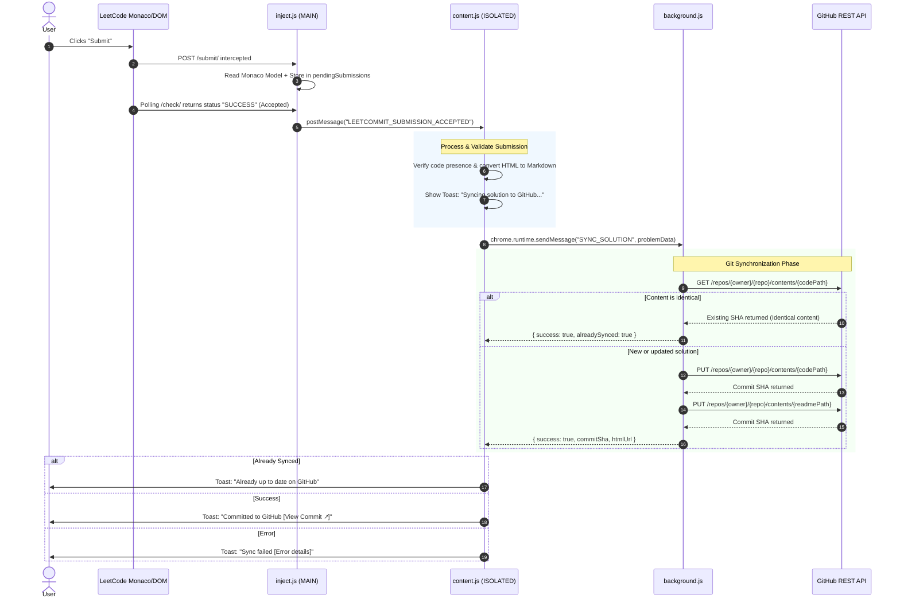

# LeetCommit — Architecture & System Design

This document details the architectural blueprint, security model, component boundaries, and end-to-end data pipelines for **LeetCommit**, a Manifest V3 browser extension for synchronizing accepted LeetCode solutions directly to GitHub.

---

## 1. Architectural Philosophy

1. **Zero-Trust & 100% Client-Side**: No intermediary proxy servers, remote logging, or backend databases. All network requests travel directly between the client's browser and `api.github.com` or `leetcode.com`.
2. **Fine-Grained Scoping**: Instead of requiring broad OAuth permissions across all user repositories, authentication utilizes scoped GitHub Personal Access Tokens (PAT) limited exclusively to a single target repository.
3. **Pristine Code Fidelity**: Code is extracted directly from Monaco Editor memory instances and official submission payloads, eliminating DOM virtualization truncations and preserving white space and comments.
4. **Idempotent Synchronization**: Remote SHA comparisons ensure that re-submitting identical solutions does not pollute the Git history with duplicate commits.

---

## 2. High-Level System Architecture



---

## 3. Core Component Breakdown

### 3.1. `inject.js` (MAIN World Context)
* **Execution Boundary**: Injected at `document_start` inside the host page's primary JavaScript execution scope.
* **Responsibilities**:
  * Monkey-patches `window.fetch` and `window.XMLHttpRequest` to intercept submit requests to `/problems/{titleSlug}/submit/` and status polling requests to `/submissions/detail/{id}/check/`.
  * Inspects `window.monaco.editor.getModels()` to extract untruncated source code directly from editor memory.
  * Accesses Next.js internal hydration states (`window.__NEXT_DATA__`) to extract problem metadata (Frontend ID, Title, Difficulty, and Topic Tags).
  * Relays intercepted submission payloads and status notifications to the isolated content script using `window.postMessage`.

### 3.2. `content.js` & `leetcode-parser.js` (ISOLATED World Context)
* **Execution Boundary**: Standard Chrome content script environment running at `document_idle`.
* **Responsibilities**:
  * Listens for `window.postMessage` payloads dispatched from `inject.js`.
  * Implements fallback recovery: If in-memory capture misses description details, it queries LeetCode's official GraphQL endpoint (`getQuestionDetail` and `submissionDetails`) or parses the DOM as a secondary fallback.
  * Uses `leetcode-parser.js` to convert LeetCode HTML problem descriptions into clean, standard GitHub Markdown.
  * Manages floating toast notifications (`toast.css`) providing live synchronization feedback (Syncing, Success with direct Git commit link, or Failure).
  * Forwards sanitized problem datasets to the background service worker via `chrome.runtime.sendMessage`.

### 3.3. `background.js` (Manifest V3 Service Worker)
* **Execution Boundary**: Ephemeral background service worker.
* **Responsibilities**:
  * Manages extension lifecycle events (`chrome.runtime.onInstalled`).
  * Listens to single-page application (SPA) navigation transitions via `chrome.webNavigation.onHistoryStateUpdated` for direct submission URLs (`/problems/:slug/submissions/:id`).
  * Acts as the controller handling messages of type `SYNC_SOLUTION` and `VALIDATE_SETTINGS`.
  * Updates Chrome action badges (`✓`, `ERR`, or badge background colors) to reflect sync states.

### 3.4. `github-api.js` (Client-Side GitHub REST Layer)
* **Execution Boundary**: ES Module imported into `background.js` and popup controllers.
* **Responsibilities**:
  * Encapsulates GitHub REST API operations using `fetch` with `X-GitHub-Api-Version: 2022-11-28`.
  * Performs UTF-8-safe Base64 conversion (`utf8ToBase64` / `base64ToUtf8`) supporting non-ASCII code characters and mathematical symbols.
  * Implements remote file SHA resolution (`getFileDetails`) to prevent redundant duplicate commits.
  * Generates formatted problem `README.md` documents complete with Shields.io badges, runtime percentiles, memory percentiles, and tags.

### 3.5. `popup/` and `welcome/` (User Interfaces)
* **Execution Boundary**: Chrome extension views (Browser action popup and Options tab).
* **Responsibilities**:
  * Authenticates and tests user GitHub PAT permissions against target repositories.
  * Configures target repository name, default branch (`main` by default), and directory structuring format.
  * Visualizes recent sync history with status timestamps and direct GitHub links.

---

## 4. End-to-End Submission Pipeline



---

## 5. Directory Structuring Formats

The extension supports two configurable repository hierarchy models via `chrome.storage.local`:

### Format A: Flat Hierarchical Layout (Default)
```text
<repository-root>/
├── 0001-two-sum/
│   ├── two-sum.py
│   └── README.md
├── 0015-3sum/
│   ├── 3sum.cpp
│   └── README.md
└── 0142-linked-list-cycle-ii/
    ├── linked-list-cycle-ii.java
    └── README.md
```

### Format B: Categorized by Difficulty
```text
<repository-root>/
├── Easy/
│   └── 0001-two-sum/
│       ├── two-sum.py
│       └── README.md
├── Medium/
│   └── 0015-3sum/
│       ├── 3sum.cpp
│       └── README.md
└── Hard/
    └── 0042-trapping-rain-water/
        ├── trapping-rain-water.rs
        └── README.md
```

---

## 6. Security & Threat Model

| Security Vector | Risk Mitigated | Implementation Mechanism |
| :--- | :--- | :--- |
| **Token Exposure** | Over-privileged tokens leaking | Fine-Grained PATs scoped exclusively to a single repository with `Contents: Read and write`. No organization or account-wide permissions required. |
| **Data Interception** | MITM / Token theft | No proxy servers or third-party backends. Browser initiates direct HTTPS connections to `https://api.github.com/*`. |
| **Credential Storage** | Plaintext local extraction | Credentials stored in isolated `chrome.storage.local`, unaccessible to regular web pages or external scripts. |
| **Blank Commits** | Overwriting solutions with empty files | Triple verification guards in `inject.js`, `content.js`, and `github-api.js` throw errors if `code.trim().length === 0`. |
| **Virtual DOM Truncation** | Incomplete code commits | Directly reads from Monaco editor text models (`model.getValue()`) rather than virtualized DOM elements (`.view-line`). |
